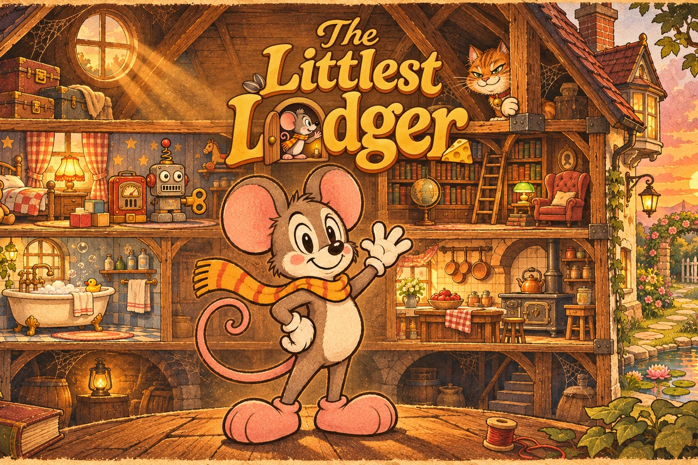

# The Littlest Lodger

> ⚠️ **Design előtti verzió – v0.13.5 (2026. november 6.)**
> A játékmenet és mind a tíz pálya végigjátszható, és már mind a tíz helyiség festett grafikát kapott. Minden helyiségnek saját zenéje van, és mindegyikben elrejtettünk egy titkos egérjáratot. Magyarul és angolul is játszható.

Cincin, a kis sálas egér egy hatalmas, régi házban lakik. A padlástól a kertig tíz helyiségen kell átjutnia, és mindegyik végén egy furfangos ellenfél vár rá: az alvó macska, a felhúzható óriásrobot, a bagoly, a szakács, a kutya, a patkány… Gyűjtsd a magokat, keresd meg minden szobában a rejtett sajtot, kússz be a bútorok alá, és találd ki, hogyan jutsz túl a szoba urán.

**A ház helyiségei:**
1. Padlás · 2. Gyerekszoba · 3. Könyvtár · 4. Fürdőszoba · 5. Konyha · 6. Kamra · 7. Nappali · 8. Garázs · 9. Pince · 10. Kert (finálé)

Minden teljesített helyiség megnyitja a következőt.

**Titkos egérjáratok:** minden helyiség falában van egy halványan derengő, apró lámpafüzéres egérlyuk. Állj elé, és nyomd meg a ↓ gombot: egy rövid, nehezebb bónuszpálya vár a fal mögött, plusz magokkal, egy barátságos lakóval (Nagyapó vagy a két egérgyerek), a végén pedig ajándékkal – új sállal Cincinnek vagy egy festménnyel a galériába. A sálat a szünet menüben lehet cserélni.

## Játék

**Játék:** https://gzdirect.github.io/jatekok/cincin/

Nyisd meg a játékot a böngészőben. Telefonon és tableten teljes képernyőn, érintéssel is játszható.

| | Billentyűzet | Érintőképernyő |
|---|---|---|
| Futás | ← → / A D | bal kör oldalra húzva |
| Ugrás | Szóköz / W / ↑ (nyomva tartva magasabb) | jobb gomb |
| Guggolás, kúszás | ↓ / S | bal kör lefelé / ferdén |
| Lelépés platformról | ↓ + ugrás | |
| Vissza az egérlyukhoz | R | szünet menü |
| Szünet | Esc / P | ⏸ gomb |
| Hang ki/be | M | szünet menü (a zene külön is kikapcsolható) |

Kontrollerrel is működik.

## Teszteléshez

A tesztelők ezt a címet kapják: `…/cincin/?teszt` – így a szünet menüben megjelenik a **Teszt-adatok** gomb, ami kimásolja, hol és mitől buktál el a legtöbbször. Ezt küldd vissza a fejlesztőnek. (A `?dev` cím a fejlesztői panelt is megmutatja.)

## Fájlok

- `index.html` – a játék
- `art/` – a képek (a játék pályánként tölti be őket, ezért ennek a mappának is fent kell lennie)
- `fonts/` – a betűtípusok (IM Fell English, IM Fell English SC, Figtree, Lodger Mono – SIL Open Font License, lásd `fonts/OFL.txt`)
- `manifest.webmanifest` – a telepíthető (kezdőképernyőre tehető) változat leírója
- `sw.js` – a service worker: a címképernyő és a padlás internet nélkül is indul, a többi kép az első megnézéskor kerül gyorsítótárba
- `favicon-32.png`, `apple-touch-icon.png`, `icon-192.png`, `icon-512.png`, `icon-512-maskable.png` – ikonok
- `social-preview.jpg` – megosztási előnézet (1200×630)
- `LICENSE` – felhasználási feltételek

## Változások

- **v0.13.5** – Keskeny ablakban a bal felső eredménysáv a szélességhez igazodva összemegy, így nem csúszik a szünet- és teljes képernyő gomb alá.
- **v0.13.4** – Új festett effektek: tinta- és mézfröccs a lehulló cseppeknél és a ragacsos padlón, gőzpamacsok a teáskannánál és a felforrósodó főzőlapoknál, konfetti a célba érkezéskor, csillagok a csatornába bukó patkány feje körül.
- **v0.13.3** – Mind a tíz helyiség saját festett padlómetszetet kapott a padló alatt (gerendák, csövek, téglák, föld és elveszett apróságok), a játékvonat alagútja festett belsőt; a mesekönyv 5. és 6. oldalán Cincin már kesztyűt és rózsaszín cipőt visel.
- **v0.13.2** – A gyerekszobai kockavár udvarából lépcső vezet ki; a címlap nem görgethető, így nem látszik rajta sötét sáv; az előtér-réteg (elmosódott tárgyak a kép szélén) kikerült a játékból.
- **v0.13.1** – Grafikai javítások az átnézés után: a padló alatti sima sávok és a helyiségek szélső falai festett deszkát kaptak (a fürdőszobában csempét), a gyerekszobai polcfal hátlapja is; a padlás alacsony komódja és a kamra ládaoszlopa festett képet kapott; eltűnt a konyhai előtér elmosódott barna foltja; a szobatérképen a hosszú nevek nem lógnak ki.
- **v0.13** – Tíz festett képregénypanel: minden helyiség főellenségénél (macska, óriásrobot, bagoly, árvíz, szakács, egérfogók, állóóra, kutya, patkány, kerti macska) az első találkozáskor megáll a játék, és beúszik a jelenet; a látott panelek a Galériába kerülnek. Új borítókép és megosztási előnézet.
- **v0.12.1** – Javítások: a padló alatti kúszóterek festett deszkafalat, gerendákat és padlót kaptak a sima felületek helyett; a lepedős asztalok alatt festett doboz és láda áll; a gyerekszobai kockavár polcán rés nyílt, így az udvarban lévő magok elérhetők; a kamera titkos járatban sem veszítheti szem elől Cincint. A betűtípus neve Lodger Mono.
- **v0.12** – Három új titkos alagút (köves pince, kamrai, gyökeres földjárat), festett egérlyuk-bejáratok, ajándékcsomagok és útjelző tábla, Nagyapó otthona: gyűjteményszoba a megszerzett sálakkal, festményekkel, sajtokkal és a magokkal telő befőttesüveggel. Hatfázisú szakácsjárás, négyfázisú futás és új pózok a macskának, a kutyának és a patkánynak. festett effektek (por, csillogás, fröccs, ütés, borsfelhő), új konyhai elszívó, sortördelt üzenetek.
- **v0.11.1** – Betűtípusok pótlása, ikonok, megosztási előnézet, telepíthető és offline is induló változat.
- **v0.11** – Új név: **The Littlest Lodger** (a főszereplő továbbra is Cincin). Festett címképernyő logóval és élő Cincinnel, a pályaválasztó egy kettévágott ház, amelyben a szobákra kell kattintani, festett menük, gombok, csúszkák és ikonok, festett eredmény-jelvények, hat új mesekönyv-oldal. Cincin új, festett pózokat kapott: futás, ugrás, esés, landolás, megtorpanás, guggolás, kúszás, tolás, pislogás, nézelődés, ütés, szédülés, győzelmi ugrás.
- **v0.10** – Új, teljes alakos szakács a konyhában (járás, seprűemelés, söprés, tüsszentés, menekülés repülő sapkával), a seprű porfelhőt sodor a padlón. Tíz titkos egérjárat a falak mögött: gyufásdoboz-ágyak, cérnaorsók, gyűszűk, kupakpolcok, dominólépcső, zokniágy, gyufásdoboz-lift, szardíniásdoboz-csónak, csipeszlétra; Nagyapó és a két egérgyerek tanácsot ad. Ajándékba öt új sál (pöttyös piros, csíkos zöld, csillagos kék, kockás lila, koronás sárga) és öt új festmény a galériában, két új eredmény.
- **v0.9** – Profibb megjelenés: a tesztelői és fejlesztői gombok csak a `?teszt` / `?dev` címmel látszanak, a billentyűlista egy „?” gomb mögé került, a betűtípusok a játékkal együtt töltődnek. Új: mesekönyves bevezető és befejezés, galéria, eredmények, angol nyelv, zene- és hangerő-csúszkák, írisz-áttűnés haláknál és újrakezdésnél, ünneplés a szoba végén, előtérben szálló por, ráugrásnál rövid megállás, mentőpont-csillogás, gombhangok, töltőcsík. Javítva: a könyvtári fotel magja, a dupla egérlyuk, a lebegő háttértárgyak, a kád ritmusa, a konyhai szagelszívó és a karikák elérése.
- **v0.8** – Festett grafikát kapott a konyha, a kamra, a nappali, a garázs, a pince és a kert is: új hátterek és padlók, bútorok, edények, befőttek, zsákok, kandalló, zongora, állóóra belseje, öreg autó, kerti növények – és az új ellenfelek: a szakács, a csótányok, a kutya, a bogarak és ászkák, a patkány és a csigák. Minden helyiségnek saját, régi rajzfilmes zenéje van, a főellenségnél gyorsabb és sötétebb; a szünet menüben külön kikapcsolható.
- **v0.7** – A fürdőszoba festett grafikát kapott: új háttér, hatszögletű csempepadló, festett víz és hullámok, gumikacsa, szappanok, szivacs, buborékok, mosdó, kád, csapok, üvegcsék, zuhanyfüggöny-karikák, a vizes akna csempéi és a rézszelep. A könyvtár padlója is festett deszkát kapott.
- **v0.6** – A könyvtár festett grafikát kapott: új háttér, nyíló és morzsolódó könyvek, tintás polcok és tintacseppek, görgős létra, könyvmolyok, guruló földgömb, sámlik, bőrfotel, íróasztal zöld lámpával, kalitka – és az új bagoly.
- **v0.5.1** – Gyerekszoba-javítások: a háttér padlója most egy vonalban van a játék padlójával (a várudvar magjai már láthatóan elérhetők), az ablakpad rajza a helyére került, eltűnt a fölösleges második egérlyuk a robot előtt, sűrűbben gurulnak a golyók, a golyós polctorony festett kockákat és könyveket kapott, és gyorsabb, keményebb az óriásrobot.
- **v0.5** – A gyerekszoba festett grafikát kapott (háttér, játékok, babaház, ágy, óriásrobot). A képek külön fájlokba kerültek, a játék pályánként tölti be őket. A pályák sorban nyílnak meg. Új kezdőképernyő, nagyobb ugrógomb, ritkább golyók a polctornyon.
- **v0.4** – A padlás teljesen festett grafikát kapott; új egér (mozgó végtagokkal) és új macska; hibajavítások a mentőpontoknál és elérhetetlen magoknál.
- **v0.3** – Mobil- és tabletbarát, teljes képernyős változat menükkel, érintéses irányítással és teszt-naplóval.
- **v0.2** – Mind a tíz helyiség elkészült a főellenségekkel.
- **v0.1** – Első prototípus: mozgás, ugrás, kúszás, a padlás.

## Állapot

Egyfájlos HTML5 canvas prototípus. A végleges változat Godot 4-ben (GDScript) készül.

---

© 2026 Fejes Géza. Minden jog fenntartva. Lásd: [LICENSE](LICENSE).
